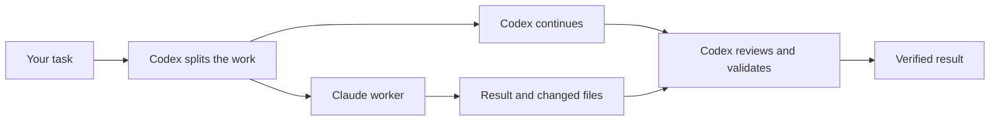

# Claude Code Delegate

**Codex leads. Claude works in parallel.**

[](https://github.com/dlfoster311/codex-claude-delegate/actions/workflows/ci.yml)
[](LICENSE)
[](https://nodejs.org/)

A Codex skill that assigns useful work to your local Claude Code CLI while Codex continues the
main task. Use both platforms to finish work sooner and share the workload between their allowances.

No API key is required for an existing Claude subscription login. The runner has no npm dependencies.

[Install](#install) · [How it works](#how-it-works) · [Usage awareness](#usage-awareness) · [Validation](#validation)

## Install

You need Node.js 22 or later, Git, Codex, and the native Claude Code CLI. Sign in to Claude Code
with its normal login before you start.

```sh
git clone https://github.com/dlfoster311/codex-claude-delegate.git
cd codex-claude-delegate
node scripts/install.mjs --enable-default
```

This installs the skill in `$CODEX_HOME/skills`, or `~/.codex/skills`. It also adds a short delegation
rule to the active global Codex instruction file. Existing instructions stay in place. The installer
keeps a backup and checks the installed file hashes.

The skill is available on your next Codex turn. Start a new chat to load and check the global rule.
For a skill-only install, omit `--enable-default`. For an update, add `--update`.

You can also use the Codex skill installer with this repository and the path
`skills/claude-code-delegate`. That installs the skill without changing global instructions.

## Use it

Give Codex a normal substantial task. For example:

> Add CSV export to the report page. Use parallel work where it helps.

Codex can assign tests or a separate implementation task to Claude while it builds another part.
You can also select the skill directly:

> Use $claude-code-delegate to investigate this defect while you check the failing tests.

| Codex | Claude Code |
| --- | --- |
| Plans the work and defines each assignment | Completes a bounded assignment |
| Does the main implementation or investigation | Implements, investigates, tests, or reviews a bounded part |
| Reviews changes and runs required checks | Returns files, findings, tests, and blockers |
| Integrates the result and reports to you | Keeps its work within the assigned scope |

## How it works



- **Start early with one assignment.** Add a second worker only when Codex still has substantial independent work.
- **Keep Codex active.** Codex does the main implementation or investigation while Claude works on a bounded part.
- **Name both results.** State what each platform will produce. Reviewing and applying Claude output alone is not enough.
- **Reassess the next assignment.** A completed worker does not automatically receive another task.
- **Choose the model.** Use Sonnet for routine work and Opus for difficult work.
- **Separate edits.** Use isolated worktrees and clear file ownership.
- **Check the result.** A successful CLI run is not proof that the task is complete.
- **Stop when needed.** Cancellation stops the worker and retains its files and partial output.

Simple tasks stay in Codex when delegation would add delay. No fixed split or spending quota applies.

If you ask for less delegation, Codex keeps the main work and reduces the size or number of Claude
assignments. It still uses Claude when useful independent work remains. An explicit request to stop
Claude takes precedence. More available Claude usage does not transfer all substantive work to Claude.

## Usage awareness

The skill can compare fresh Codex and Claude account usage when both expose suitable data. It keeps
five-hour and weekly windows separate and shows reset times. It does not equate plan capacities.

Claude Code 2.1.308 returned both windows through `rate_limit_info.unifiedWindows` in the local
validation. Older versions or other accounts can omit these fields. Missing or stale data stays
unknown. Usage collection does not delay work.

The runner also records task tokens, duration, and CLI cost estimates. Estimates are not invoices,
subscription percentages, or proof of money saved. It does not enable overage or change billing.

Read the [usage reference](skills/claude-code-delegate/references/usage.md) for supported fields.

## Runner

The skill uses these commands:

| Command | Result |
| --- | --- |
| `start` | Starts a job and returns its ID. |
| `status` | Reads the current job state. |
| `result` | Reads the compact result and usage. |
| `cancel` | Requests cancellation; check status to confirm it stopped. |

Try the included investigation example from the repository root:

```sh
node skills/claude-code-delegate/scripts/runner.mjs start --workspace examples/clamp --task examples/investigate.json
```

Use the returned ID with `status --job`, `result --job`, or `cancel --job`.
See the [runner reference](skills/claude-code-delegate/references/runner.md) for task files and options.

Read mode has no shell or write tools. Edit mode permits named files and explicit validation commands.
The worker uses normal Claude permission checks. It does not use a permission bypass. Custom hooks,
plugins, and unrelated MCP servers are disabled for the worker session. Saved Claude settings stay unchanged.

The worker is a local process, not an operating-system sandbox. Use trusted workspaces. A permitted
test command can execute project code. Review its effects before you permit it.

Job files stay in the local state directory. They can contain source code and task details. Do not
publish them. The helper retains them until you remove them.

## Repository layout

```text
skills/claude-code-delegate/   Portable Codex skill, runner, and references
scripts/                      Install, syntax checks, and live smoke test
tests/                        Automated tests with a local fake CLI
examples/                     Small project and valid task briefs
.github/workflows/            Windows, Linux, and macOS CI
```

## Validation

```sh
npm run check
```

The automated suite uses a local fake CLI. It does not call Claude or consume account usage.
It checks concurrent jobs, cancellation, failed output, path handling, installation, and usage data.
There is no separate build step because the package contains plain JavaScript.

For a real CLI check, run:

```sh
npm run smoke:live
```

This uses your Claude allowance. It starts a read-only investigation and an isolated code fix in
parallel. It verifies the changed file and tests after both finish. It keeps evidence under ignored
`work/` files. Read [VALIDATION.md](VALIDATION.md) for the recorded release checks and limitations.

## Contribute

See [CONTRIBUTING.md](CONTRIBUTING.md). Keep changes small and verify the affected behavior.

MIT licensed. This is an independent project. It is not an official OpenAI or Anthropic product.
